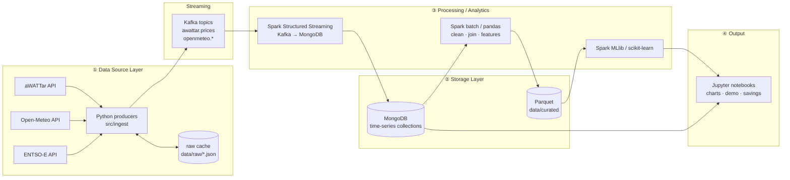

# Architecture

## Overview



## Which tool for what

| Task | Tool | Why |
|---|---|---|
| Call APIs, parse JSON, flatten into rows | **requests + pandas** | Each response is small (≤ ~90k rows); pandas is the simplest way to turn it into rows |
| Transport, buffering, replay | **Kafka** (`confluent-kafka` producer) | Durable log; decouples the data sources from processing |
| Kafka → MongoDB | **Spark Structured Streaming** | Reads the topics continuously, parses JSON, upserts by key |
| Clean, deduplicate, join, window features | **Spark (batch)** | Required component; window functions for lag/rolling features |
| Storage | **MongoDB** time-series collections + **Parquet** | NoSQL storage for measurements; columnar files for ML |
| Exploration, plots, small ML experiments | **pandas, matplotlib, scikit-learn** | Fast iteration in notebooks on the stored data |

pandas is **not** a stream processor: it works on data that is already in memory and cannot read from Kafka continuously. That is why the hand-over is Kafka → Spark.

## Decision: storage yes, streaming kept small

| Component | Required by the assessment? | Decision |
|---|---|---|
| MongoDB (NoSQL) | **Yes** – "Data Storage" (5 points) and "Components to be used" (NoSQL) | Mandatory |
| Spark | **Yes** – "Components to be used" | Mandatory |
| Kafka / streaming | No | Kept, but used narrowly |

Kafka is optional. We keep it because the team wants a streaming component, it gives a strong *Velocity* argument and a live demo, and it is a clean hand-over between team members. To keep the risk low, **only one Spark streaming job** reads Kafka and writes to MongoDB. All analysis and ML runs in batch on the stored data. If time gets short, Kafka can be dropped: the producers can write to MongoDB directly, and nothing downstream changes.

The data sources themselves are slow (prices once per day, forecasts hourly), so the stream is low-frequency. The architecture would carry 15-minute or real-time data unchanged. We discuss this honestly in the Big Data reflection.

## How the producer works

### Kafka in one paragraph

A **topic** (e.g. `awattar.prices`) is an append-only log. A **producer** appends messages at the end. Each message has a **key**, a **value** and a position number, the **offset**. A **consumer** (Spark) reads at its own pace and remembers which offset it reached. Reading does not delete anything, so a new consumer can re-read everything from offset 0.

```
awattar.prices   offset:  0              1              ...   69142
                 key:     2019-01-01T00  2019-01-01T01  ...
                 value:   {"ts": ..., "price_eur_mwh": 28.1, "source": "awattar", ...}
                                                              ▲ producer appends here
                 Spark reads from offset 0 → ... and stores how far it got (checkpoint)
```

### Backfill: `python -m src.ingest.stream backfill awattar --start ... --end ...`

1. `awattar.load_prices()` loads each year from `data/raw/awattar/` and calls the API only for years that are missing (and the current year).
2. `to_dataframe()` turns the JSON into a table with one row per hour, timestamps in UTC.
3. `publish()` in [`producer.py`](../src/ingest/producer.py) goes through the table row by row:
   - **Key:** the timestamp for prices, `location|timestamp` for weather.
   - **Value:** the row as JSON, plus `source` and `ingested_at`. `NaN` becomes `null`.
   - `producer.produce(...)` does not send immediately. It puts the message in a local queue; a background thread of the Kafka client sends it in batches (up to 50 ms collection window, zstd compression).
   - If the local queue is full (e.g. 87,000 weather rows per year), the `BufferError` is caught, the producer waits briefly and retries.
4. `producer.flush()` waits until Kafka has confirmed every message. If some are still undelivered, it raises an error, so nothing is lost silently.
5. `enable.idempotence` ensures that a message the client re-sends after a network hiccup is not stored twice.

History and live data go through the **same path** (Kappa architecture), so the consumer needs only one version of its code.

### Live: `python -m src.ingest.stream live --interval 900`

A loop that runs every 15 minutes:

- **Prices:** fetches yesterday, today and tomorrow. A `seen_prices` dictionary remembers what was already sent, so only new or changed prices are published. Tomorrow's prices appear once a day around 13:00 CET.
- **Forecast:** fetches the current forecast for all 10 locations and sends all of it, with `issued_at`. The forecast for the same hour changes with every model run; keeping every version allows analysing how forecasts change.
- If an API or Kafka is briefly unavailable, the error is printed and the next cycle tries again.

Message formats and keys: see [data-contract.md](data-contract.md).

## Infrastructure

All services are defined once in [`docker-compose.yml`](../docker-compose.yml):

| Service | Image | Inside Docker | From the host | Started by |
|---|---|---|---|---|
| MongoDB | `mongo:7.0` | `mongodb://mongo:27017` | `mongodb://localhost:27017` | always |
| Kafka (KRaft, single node) | `apache/kafka:3.9.1` | `kafka:9092` | `localhost:9094` | always |
| Kafka UI | `provectuslabs/kafka-ui:v0.7.2` | – | http://localhost:8080 | always |
| Dev container | `mcr.microsoft.com/devcontainers/python:1-3.12-bookworm` + Java 17 | – | – | VS Code Dev Containers |
| JupyterLab + PySpark | `quay.io/jupyter/pyspark-notebook:spark-3.5.3` | – | http://localhost:8888 (token `fph`) | `--profile jupyter` |

Connection settings come from environment variables (`MONGO_URI`, `KAFKA_BOOTSTRAP`). Inside the containers, `docker-compose.yml` sets the container-network addresses. Locally they come from `.env` (template: `.env.example`).

To reset all stored data (Kafka topics and MongoDB): `docker compose down -v`.
